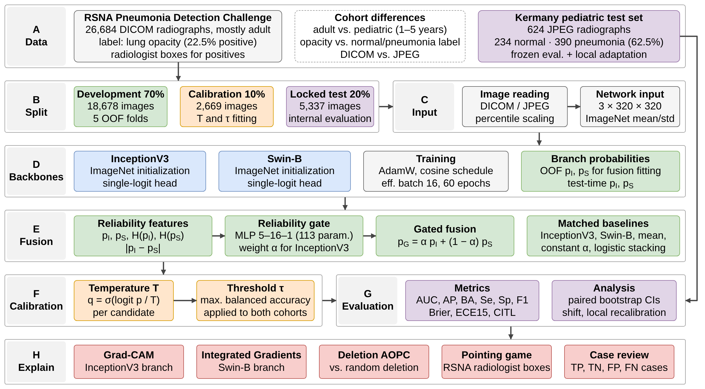
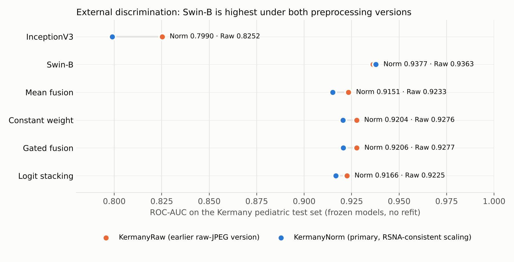

# TRACE-CXR

**Reliability-aware fusion and calibration transport for pneumonia classification on chest X-rays.**

Research software and aggregate evidence for the paper *TRACE-CXR: Evaluating Reliability-Aware Fusion and Calibration Transport for Pneumonia Classification on Chest X-Rays* (IEEE DeSE 2026). The code is released under the [MIT License](LICENSE). This is **not a clinical diagnostic system**.

The repository contains a CPU-only command-line tool that checks the frozen configuration, the fusion and calibration formulas and the published aggregate results; the RSNA partition list (`data/`); and the historical training and evaluation code (`training/`). The frozen model weights are attached to [Release v1.0.0](https://github.com/mariamarcelinaw/TRACE-CXR/releases/tag/v1.0.0). It does not contain medical images, labels, per-image predictions or NIH patient identifiers (the RSNA `patientId` in `data/` identifies an image, not a patient).




## Key results

| Evidence | Result | Caveat |
|---|---|---|
| RSNA partitions | 18,678 development; 2,669 calibration; 5,337 locked test | Disjoint by RSNA `patientId` but **not by patient**: 3,645 of 5,337 test images (68.3%) come from NIH patients also in development |
| RSNA locked test, ROC-AUC | Gate 0.9020; constant weight 0.9020; Swin-B 0.8977 | Patient-disjoint test subset (post hoc): gate 0.9138 vs Swin-B 0.9035, but frozen-threshold sensitivity falls to 0.595 for both |
| Kermany external, ROC-AUC (KermanyNorm) | Swin-B 0.9377; gate 0.9206 | Swin-B is better with the reported models, not in an exploratory corrected ensemble (gate 0.9361, Swin-B 0.9327); earlier raw-JPEG version also reported in [Results](docs/results.md) |
| Frozen external calibration | Gate ECE15 0.390; calibration slope 2.12 | Calibration transported poorly; reliability diagrams in [Results](docs/results.md) |
| Local recalibration with 20 labeled Kermany images | Gate ECE15 0.093; Se 0.839; Sp 0.814 | Retrospective; sensitivity gain comes with lower specificity |
| Matched end-to-end latency (A100, 200 RSNA images × 3 interleaved rounds) | Swin-B 100.4 ms; gate 113.2 ms (+12.8 ms) | Single GPU session; includes DICOM reading and preprocessing |
| Branch attribution faithfulness (AOPC gain over random deletion) | See [Results](docs/results.md) | Explains each branch, not the complete gated predictor |



## Install and quick start

Python 3.10+ is enough. The CLI uses only the standard library and never trains models, downloads images, runs GPU inference or fits anything on external labels.

```bash
python reproduce.py --help
python reproduce.py verify      # check file checksums
python reproduce.py all         # run every check that the public files allow
python -m unittest discover -s tests -p 'test_*.py' -v
```

Checks that need per-image records are reported as **SKIPPED**, not as reproduced. Reports are written to `reports/` (ignored by Git).

Authorized users who hold the original per-image CSV files can run the stronger checks:

```bash
python reproduce.py metrics --data-root /path/to/private/evidence
python reproduce.py xai     --data-root /path/to/private/evidence
python reproduce.py timing  --data-root /path/to/private/evidence
```

No case-level data are written to the reports. Re-running training or GPU inference needs the datasets, a GPU and the code in [`training/`](training/README.md); the frozen weights are in [Release v1.0.0](https://github.com/mariamarcelinaw/TRACE-CXR/releases/tag/v1.0.0). See [Reproducibility](docs/reproducibility.md) and [Data access](docs/data_access.md).

## What is and is not reproducible here

| Component | In this repository | Status |
|---|---|---|
| Aggregate results | Yes | Checksummed; traced to archived result files |
| Frozen temperatures, thresholds and fusion weights | Yes (`configs/historical.json`) | Checked by `reproduce.py calibration` |
| Split and fold validity | Yes (`data/rsna_split_manifest.csv`) | Checked by `reproduce.py splits`; image-identifier level |
| Patient overlap (NIH patients) | Code in `analysis/patient_overlap/`; aggregate outputs in `evidence/patient_overlap_*.txt` | Needs the public RSNA–NIH mapping file and the private prediction file |
| Locked-test metrics | Only with the private prediction file | Recomputed from per-image scores |
| Local-recalibration draws | Yes (`evidence/recalibration_*.csv`, `analysis/recalibration_draws/`) | Full draw distributions, fitted intercepts/slopes and pre-specified poor-adaptation rates; code reruns from the private score file |
| Prior-shift correction, source-prior sensitivity | Yes (`evidence/prior_source_sensitivity.csv`, `analysis/prior_shift/`) | Code reruns from the private score files |
| Training and GPU inference | Code in `training/`; weights in Release v1.0.0 | Needs the datasets and a GPU; not re-run by this tool |
| Attribution maps | No | Aggregate values only |
| Latency | Only with the private raw timing file | Recomputed from per-image timings |

## Limitations

The RSNA partitions are not patient-disjoint, and patient-disjoint evaluation was post hoc without patient-grouped retraining. The original out-of-fold checkpoint selection used held-out labels; a corrected development analysis is reported separately and was not used for the final models. Independent backbone training seeds were not run. The Kermany intensity normalization (KermanyNorm) was adopted after raw-JPEG predictions existed; both versions are reported. An InceptionV3 inference defect (`transform_input`) was fixed after the first test scores had been seen. Local adaptation is retrospective and uses Kermany labels, so it is separate from the frozen external evaluation. Full details are in [Limitations](docs/limitations.md).

## Citation and license

Code and documentation: MIT License (see [LICENSE](LICENSE)). The RSNA and Kermany datasets and the torchvision pretrained weights are **not** included and remain under their own terms. The released model weights were trained on RSNA Pneumonia Detection Challenge data; their use is subject to that dataset's terms, for research only and not for clinical decision-making. Citation metadata are in [`CITATION.cff`](CITATION.cff); the proceedings DOI will be added after publication.
