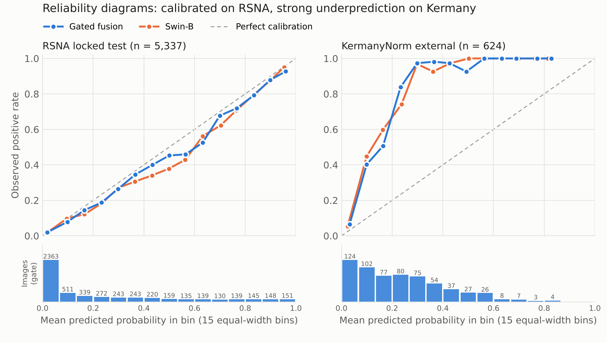
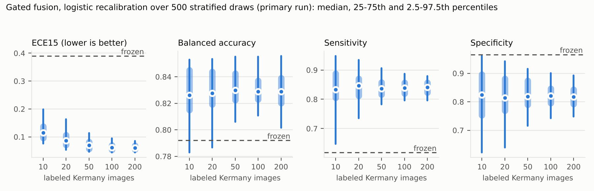
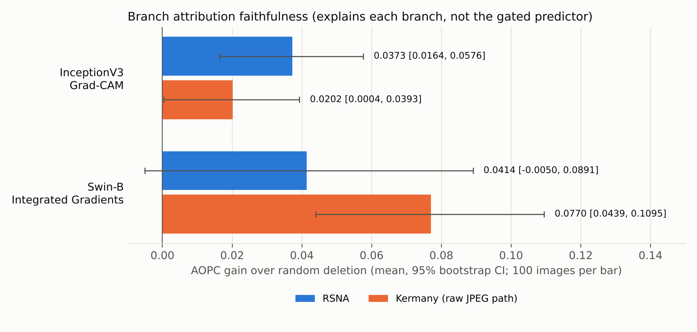

# Results and provenance

All aggregate values below come from archived result files of the study. Machine-readable values are in [`evidence/verified_results.csv`](../evidence/verified_results.csv). The public CLI does not generate new clinical results.

## External cohort: two preprocessing versions

The Kermany test set (624 JPEG images from 427 patients) was first scored with images read as plain JPEG (**KermanyRaw**). The RSNA images had been read as DICOM with a per-image 0.5–99.5 percentile intensity stretch, which the JPEG path did not apply. After the raw predictions existed, the same stretch was applied to the Kermany images (**KermanyNorm**) so that both cohorts use one preprocessing pipeline. Weights, gate, temperatures and thresholds were unchanged, and no Kermany labels were used for fitting.

The paper reports KermanyNorm as the primary external result. Both versions are listed here, because the switch was made after the raw results had been seen. The change lowered the gate and raised Swin-B, so it did not favor the proposed fusion.

| Model | ROC-AUC Raw | ROC-AUC Norm | BA Raw | BA Norm | Se Raw | Se Norm | Sp Raw | Sp Norm | ECE15 Raw | ECE15 Norm |
|---|---|---|---|---|---|---|---|---|---|---|
| InceptionV3 | 0.8252 | 0.7990 | 0.7410 | 0.7077 | 0.5846 | 0.5436 | 0.8974 | 0.8718 | 0.3758 | 0.3853 |
| Swin-B | 0.9363 | **0.9377** | 0.8265 | 0.8308 | 0.7128 | 0.7000 | 0.9402 | 0.9615 | 0.3527 | 0.3659 |
| Mean fusion | 0.9233 | 0.9151 | 0.8013 | 0.7829 | 0.6410 | 0.6000 | 0.9615 | 0.9658 | 0.3771 | 0.3892 |
| Gated fusion | 0.9277 | 0.9206 | 0.8141 | 0.7919 | 0.6667 | 0.6179 | 0.9615 | 0.9658 | 0.3774 | 0.3898 |
| Constant weight | 0.9276 | 0.9204 | 0.8162 | 0.7919 | 0.6667 | 0.6179 | 0.9658 | 0.9658 | 0.3756 | 0.3879 |
| Logistic stacking | 0.9225 | 0.9166 | 0.7893 | 0.7765 | 0.6128 | 0.5872 | 0.9658 | 0.9658 | 0.4039 | 0.4154 |

Under both versions Swin-B has the highest external ROC-AUC, and the gate matches the constant weight. The Kermany attribution analyses used the raw JPEG path.

## Calibration: reliability diagrams and bin counts

The reliability diagrams below use the same 15 equal-width bins as ECE15. The lower panels give the number of images per bin for the gate. Per-bin values for all six candidates are in [`evidence/reliability_bins.csv`](../evidence/reliability_bins.csv); intercept, slope, NLL, Brier, ECE15 and calibration-in-the-large are in [`evidence/calibration_summary.csv`](../evidence/calibration_summary.csv). Intercept and slope come from an unpenalized logistic fit of the outcome on the logit of the calibrated score (ideal: 0 and 1).

| Cohort | Model | Mean predicted | Prevalence | Intercept | Slope | NLL | ECE15 |
|---|---|---|---|---|---|---|---|
| RSNA locked test | Gated fusion | 0.246 | 0.225 | −0.228 | 0.955 | 0.319 | 0.021 |
| RSNA locked test | Swin-B | 0.255 | 0.225 | −0.303 | 0.949 | 0.327 | 0.030 |
| KermanyNorm | Gated fusion | 0.235 | 0.625 | 4.116 | 2.119 | 0.837 | 0.390 |
| KermanyNorm | Swin-B | 0.259 | 0.625 | 3.797 | 1.897 | 0.760 | 0.366 |

On Kermany both the intercept and the slope move far from their ideal values, so the external miscalibration is not a pure intercept shift. Bins above 0.6 hold few Kermany images (22 of 624 for the gate), so their observed rates are unstable.

## Prior-shift correction and the source prior

The frozen KermanyNorm scores were prior-corrected without refitting any model (Saerens et al. EM, no Kermany labels) and, as a reference, with the true Kermany prevalence (0.625). The paper's source prior `pi_s` is the mean calibrated score on the RSNA calibration split, i.e. the prior implied by the calibrated model; the observed calibration-split prevalence (0.225) was checked as an alternative. Values for all six candidates are in [`evidence/prior_source_sensitivity.csv`](../evidence/prior_source_sensitivity.csv) (code: [`analysis/prior_shift/`](../analysis/prior_shift/README.md)).

| Model | `pi_s` definition | `pi_s` | EM `pi_t` | ECE15 frozen | ECE15 after EM | ECE15 true-prevalence reference |
|---|---|---|---|---|---|---|
| Gated fusion | mean calibrated score | 0.247 | 0.182 | 0.390 | 0.443 | 0.145 |
| Gated fusion | observed prevalence | 0.225 | 0.283 | 0.390 | 0.342 | 0.134 |
| Swin-B | mean calibrated score | 0.254 | 0.276 | 0.366 | 0.349 | 0.132 |
| Swin-B | observed prevalence | 0.225 | 0.371 | 0.366 | 0.254 | 0.113 |

With either choice, EM stays far below the observed Kermany prevalence and leaves ECE15 high, while even the true-prevalence reference does not remove the miscalibration, consistent with a shift that is not a pure prior shift. Decisions at the mapped threshold are unchanged by prior correction. In the historical scripts the true-prevalence reference is named `ECE_oracle`.

## Gate stability and the corrected development analysis

**Training length (original out-of-fold scores).** `analysis/gate_convergence_check.py` cross-fits the gate over the five original OOF folds (development data only; output in [`evidence/gate_convergence_result.txt`](../evidence/gate_convergence_result.txt)). The archived 60-step gate gives held-out OOF ROC-AUC 0.8894 with α between 0.395 and 0.503. Training the same gate to convergence (L-BFGS) widens α to 0.086–0.834 but gives 0.8887, against 0.8894 for the constant weight; equal averaging gives 0.8892 and Swin-B 0.8813.

**Corrected development analysis.** Each fold checkpoint was re-selected on an inner validation subset of its training portion (split list: [`data/corrected_inner_split_manifest.csv`](../data/corrected_inner_split_manifest.csv)), and all fusion rules were cross-fitted over the five development folds. Held-out ROC-AUC was 0.8894 for the gate, 0.8892 for the constant weight and 0.8844 for Swin-B; gate minus constant weight was +0.0002 [+0.0000, +0.0003] (500 image resamples). Across five gate initializations on these corrected scores, held-out ROC-AUC ranged 0.8891–0.8894, the gate-minus-constant difference ranged −0.0001 to +0.0002 and mean α ranged 0.380–0.499. Evidence: `evidence/corrected_development_*.csv` and `evidence/gate_initialization_stability.csv`; code: [`analysis/corrected_development/`](../analysis/corrected_development/README.md).

## Exploratory corrected five-fold ensemble

To address the out-of-fold checkpoint-selection dependence, a corrected analysis selected each fold checkpoint on an inner validation subset. As an exploratory check, the five corrected fold checkpoints of each backbone were averaged, combined with fusion parameters fitted on the corrected out-of-fold scores, calibrated on the RSNA calibration split, and scored on both test cohorts. Both cohorts had already been seen, so this is not a new blind evaluation, and it does not replace the main tables.

| Model | RSNA ROC-AUC (reported) | RSNA ROC-AUC (corrected ensemble) | Kermany ROC-AUC (reported) | Kermany ROC-AUC (corrected ensemble) |
|---|---|---|---|---|
| Swin-B | 0.8977 | 0.9034 | **0.9377** | 0.9327 |
| Mean fusion | 0.9018 | 0.9058 | 0.9151 | 0.9345 |
| Constant weight | 0.9020 | 0.9057 | 0.9204 | 0.9365 |
| Gated fusion | 0.9020 | 0.9058 | 0.9206 | 0.9361 |
| Logistic stacking | 0.9020 | 0.9054 | 0.9166 | 0.9379 |

In the corrected ensemble, gate minus Swin-B on Kermany was +0.0034 [−0.0034, +0.0101] in ROC-AUC (image bootstrap), and gate minus constant weight was −0.0004 [−0.0015, +0.0007]. The gate still matches the constant weight, but the Swin-B advantage seen with the reported models is not reproduced. At the frozen thresholds, Kermany sensitivity and specificity were 0.715/0.944 for the gate and 0.487/0.979 for Swin-B, so threshold-based comparisons are also protocol-dependent.

## Monte Carlo stability of the RSNA BA interval

The RSNA gate-minus-Swin-B BA interval in Table III ([+0.0005, +0.0141], 2,000 resamples, seed 20260908) has a lower bound close to zero, so it was checked for Monte Carlo error with the same resampling scheme ([`analysis/bootstrap_seed_sensitivity.py`](../analysis/bootstrap_seed_sensitivity.py), output in [`evidence/bootstrap_seed_sensitivity_result.txt`](../evidence/bootstrap_seed_sensitivity_result.txt)). The archived interval is reproduced exactly. Over seeds 1–200 the lower bound has median +0.0005 (range −0.0002 to +0.0010) and is at or below zero for 2.5% of seeds; with 20,000 resamples it is +0.0004. The interval therefore excludes zero only narrowly, as stated in the paper, and this is not an artifact of the chosen seed.

## Kermany patient clustering

The 624 Kermany images come from 427 patients (82 contribute more than one image). The paper's Kermany intervals resample images. A post hoc patient-level paired bootstrap (2,000 resamples, KermanyNorm) gives nearly the same intervals:

| Gate minus comparator | ROC-AUC Δ [95% CI] | BA Δ [95% CI] |
|---|---|---|
| Swin-B | −0.0171 [−0.0310, −0.0039] | −0.0389 [−0.0622, −0.0150] |
| Mean fusion | +0.0056 [+0.0033, +0.0081] | +0.0090 [+0.0006, +0.0185] |
| Constant weight | +0.0003 [−0.0002, +0.0007] | 0.0000 [0.0000, 0.0000] |

## Local recalibration (retrospective)

For each labeled budget, 500 draws were taken from Kermany and evaluated on the remaining images. The rules differ by method, and the threshold choice drives the sensitivity–specificity results:

| Method | What is fitted on the labeled subset | Decision threshold |
|---|---|---|
| Threshold only | Nothing; scores stay frozen | Re-selected to maximize BA on the subset |
| Intercept only | Intercept, slope fixed at 1 | Frozen RSNA threshold (about 0.26) |
| Logistic (intercept + slope) | Intercept and slope, L2 (C = 1), lbfgs | Prevalence of the labeled subset (0.60 for n = 20) |

With 20 labeled images, logistic recalibration of the gate gave ECE15 0.093, Se 0.839 and Sp 0.814 (frozen: 0.390, 0.618, 0.966). Intercept-only recalibration reached ECE15 0.126 but Sp 0.34, because it kept the frozen threshold after the scores had shifted upward; the Sp loss is an operating-point effect. At n = 100 and 200, threshold-only adaptation reached a higher BA than logistic recalibration (0.838/0.844 vs. 0.830/0.829) but left ECE15 at about 0.39. Recalibration therefore mainly improves calibration, not BA.

Spread across draws (replicate 500-draw analysis; gate, stratified, logistic recalibration; 2.5–97.5th percentiles over draws that share evaluation images, so these are descriptive ranges, not confidence intervals):

| n | ECE15 | Se | Sp | Non-positive slopes |
|---|---|---|---|---|
| 10 | 0.121 (0.078–0.207) | 0.83 (0.62–0.96) | 0.82 (0.60–0.97) | 1 of 500 |
| 20 | 0.094 (0.054–0.159) | 0.84 (0.73–0.94) | 0.81 (0.63–0.94) | 0 |
| 50 | 0.072 (0.045–0.117) | 0.84 (0.79–0.91) | 0.82 (0.71–0.91) | 0 |
| 100 | 0.064 (0.044–0.093) | 0.84 (0.80–0.89) | 0.82 (0.73–0.90) | 0 |
| 200 | 0.061 (0.044–0.082) | 0.84 (0.80–0.88) | 0.82 (0.75–0.89) | 0 |

All models, budgets, methods and both sampling strategies are in [`evidence/recalibration_draw_summary.csv`](../evidence/recalibration_draw_summary.csv). The main-table means (for example ECE15 0.093 at n = 20) come from the primary run; this replicate gives 0.094.

### Gate versus Swin-B on identical draws

The primary run behind Table IV draws its labeled subsets from one random stream in model order, so its gate and Swin-B rows come from different subsets and are not paired. In the replicate, the per-draw seed depends on cohort, strategy, budget and draw index but not on the model, so every model is recalibrated on the same labeled images and evaluated on the same remaining images (checked through the subset hashes). On these paired draws (logistic recalibration, gate minus Swin-B; [`evidence/recalibration_gate_vs_swin_paired.csv`](../evidence/recalibration_gate_vs_swin_paired.csv), code [`analysis/recalibration_draws/paired_gate_vs_swin.py`](../analysis/recalibration_draws/paired_gate_vs_swin.py)):

| Sampling | n | ΔECE15 (mean) | Gate lower ECE15 | ΔBA (mean) | Gate higher BA |
|---|---|---|---|---|---|
| Stratified | 10 | +0.022 | 18.4% | −0.015 | 21.2% |
| Stratified | 20 | +0.019 | 14.4% | −0.016 | 11.6% |
| Stratified | 50 | +0.015 | 11.6% | −0.019 | 5.2% |
| Stratified | 100 | +0.013 | 11.0% | −0.021 | 5.2% |
| Stratified | 200 | +0.010 | 17.6% | −0.024 | 1.4% |
| Unstratified | 20 | +0.020 | 18.2% | −0.016 | 12.2% |

Swin-B stays better calibrated and more accurate after recalibration in most paired draws at every budget, which is the same ordering as the unpaired means in Table IV.

### Full draw distributions and poor adaptation

`evidence/recalibration_draw_distribution.csv` (replicate) and `evidence/recalibration_primary_run_distribution.csv` (primary run behind Table IV) give mean, median, SD, minimum, 2.5/25/75/97.5th percentiles and maximum of ECE15, BA, Se and Sp, plus the fitted intercept and slope, for every model and budget. In the primary run the logistic fits never raised a convergence warning (15,000 fits, at most 12 lbfgs iterations); the gate's slope was non-positive in 1 of 500 draws at n = 10 and 1 of 500 at n = 20, and never at n ≥ 50.

`evidence/recalibration_poor_adaptation.csv` counts the pre-specified paired events against the frozen model on the same evaluation images (P1 BA lower, P2 ECE15 higher, P3 Brier higher, P4 Se lower, P5 Sp lower, P6 fit failure; denominators are attempted draws). For the gate with stratified logistic recalibration:

| n | BA below frozen | ECE15 above frozen | Se below frozen | Sp below frozen | ECE15 > 0.2 |
|---|---|---|---|---|---|
| 10 | 11.0% | 0% | 2.2% | 97.4% | 3.0% |
| 20 | 6.6% | 0% | 0.2% | 99.6% | 0.2% |
| 50 | 0.4% | 0% | 0% | 100% | 0% |
| 100 | 0% | 0% | 0% | 100% | 0% |
| 200 | 0.4% | 0% | 0% | 100% | 0% |

`evidence/recalibration_unstratified_class_mix.csv` gives the class composition of the labeled subsets: unstratified draws at n = 10 contained 2–10 pneumonia cases, and 5 of 500 contained only pneumonia cases (single-class; recorded as fit failures and excluded from the means).

Recalibration therefore always improved calibration, almost always lowered specificity, and lowered BA in a minority of small-budget draws (unstratified n = 10: 14.8%).

## Latency

Six candidates were timed end to end, from reading the DICOM file to the CPU decision, on one A100 GPU (200 RSNA images × 3 rounds, batch 1, CUDA-synchronized). The candidate order was interleaved per image.

| Candidate | Mean (ms) | SD (ms) |
|---|---|---|
| InceptionV3 | 91.41 | 23.97 |
| Swin-B | 100.42 | 23.54 |
| Mean fusion | 112.94 | 20.93 |
| Constant weight | 113.49 | 22.29 |
| Gated fusion | 113.25 | 22.41 |
| Logistic stacking | 112.73 | 22.33 |

The paired gate-minus-Swin-B difference was +12.82 ms (+15.9, +10.6 and +12.0 ms in the three rounds). An earlier benchmark ran each candidate as a block, one after another; its timings drifted across rounds and gave +2.4 ms with the sign changing between rounds, so it was replaced by the interleaved design. The older 2.959 ms figure measured only post-processing, fusion, calibration and thresholding inside a two-backbone pipeline and is not the extra cost of fusion over Swin-B.

## Branch attribution (archived)

AOPC gain = drop in branch confidence under attribution-guided deletion minus the drop under random deletion (100 images per cohort and branch, image-level bootstrap 95% CI). Kermany values use the raw JPEG path.

| Cohort | InceptionV3 Grad-CAM | Swin-B Integrated Gradients |
|---|---|---|
| RSNA | 0.0373 [0.0164, 0.0576] | 0.0414 [−0.0050, 0.0891] |
| Kermany | 0.0202 [0.0004, 0.0393] | 0.0770 [0.0439, 0.1095] |

Pointing-game hit rate inside radiologist boxes (200 RSNA positives): Swin-B 0.660 [0.595, 0.725], InceptionV3 0.415 [0.350, 0.485]. The two branches use different attribution methods, so the gap reflects both backbone and method. Parameter-randomization and deletion-baseline checks were small pilots (8 and 4 images). None of these results explains the complete gated predictor or establishes clinical validity.

